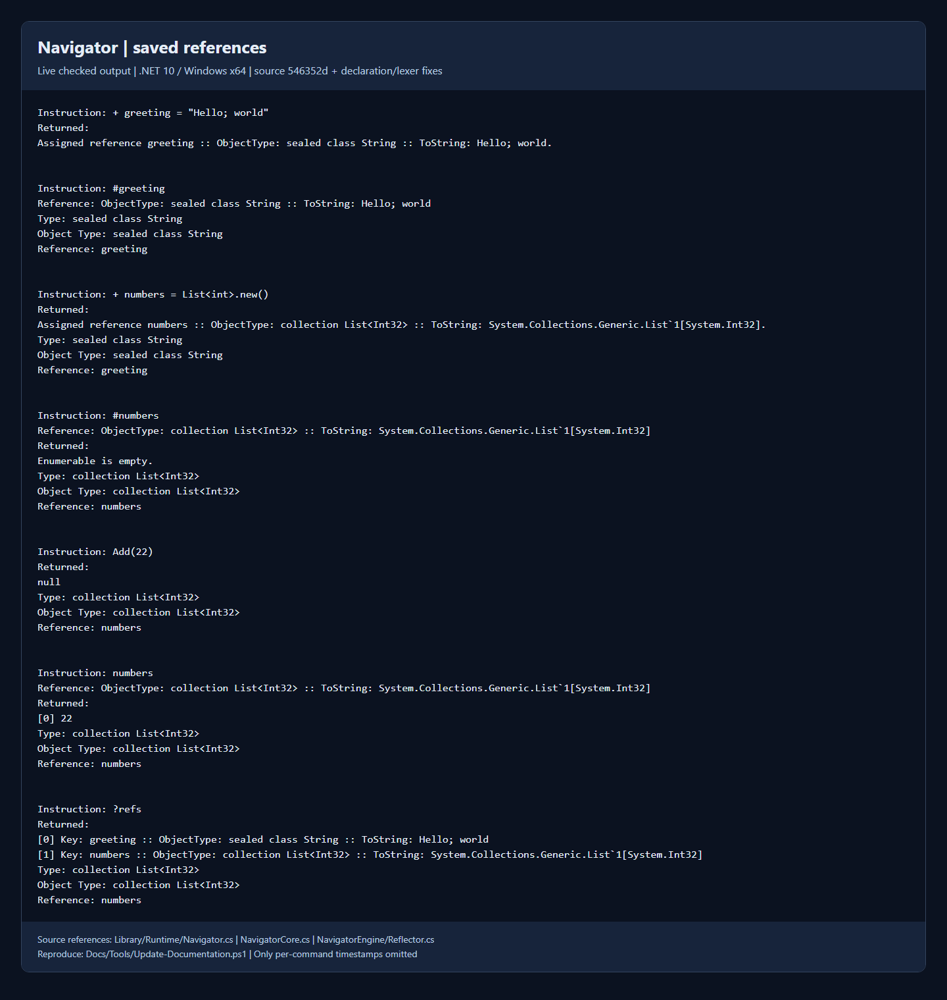
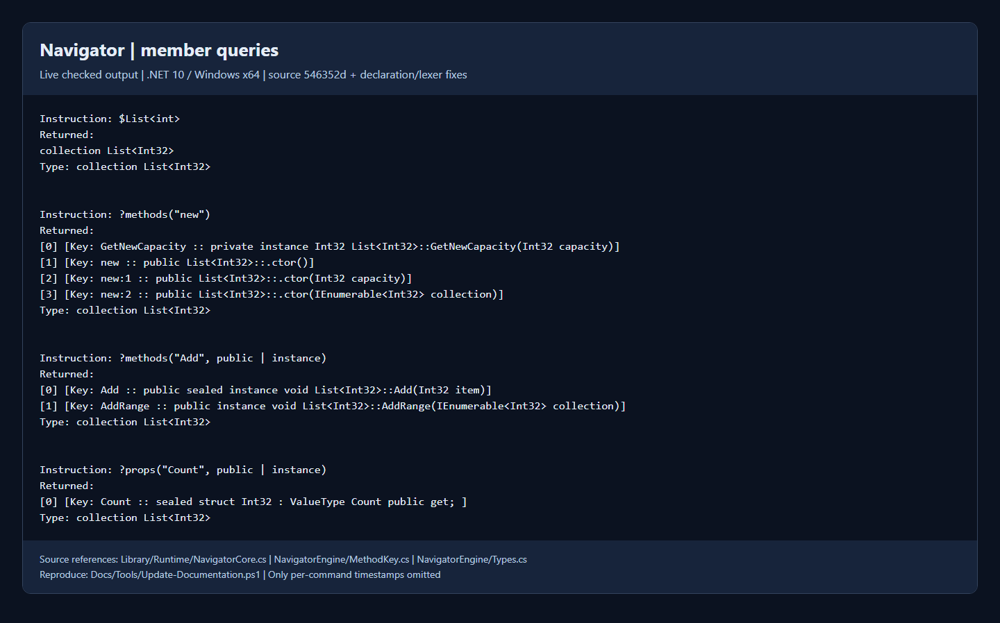

# Runtime Navigator

Navigator invokes methods, constructors, fields, and properties through strings.
It can load a static type or instance, construct generic types and methods, and
save named references to objects. Names are case-insensitive; string and
character contents keep their original case.

This is a small reflection command language, **not a C# evaluator**. The guide
describes the current source, including commit `546352d` (`smal bug fixes`).

## Contents

- [Host setup](#host-setup)
- [Controllers](#controllers)
- [Invocation and values](#invocation-and-values)
- [References](#references)
- [Constructors, overloads, and queries](#constructors-overloads-and-queries)
- [Casting and member access](#casting-and-member-access)
- [Assignment caveats](#assignment-caveats)
- [Types helper](#types-helper)
- [Limitations](#limitations)
- [Source references](#source-references)

## Host setup

Set a logger before calling `Navigator.Instruct`. Register any application types
that the commands need; common framework types are already precached.

```csharp
using System;
using XQuinn.Reflection;
using XQuinn.Runtime;

Navigator.Logger = new ConsoleNavigatorLogger();
TypeRegister.CacheType(typeof(DateTime), "Clock");

Navigator.Instruct("$Clock", "?props(\"Now\", public | static)");
Navigator.Instruct("+ message = \"Hello; world\"; #message");

sealed class ConsoleNavigatorLogger : NavigatorLogger
{
    public override void ToLog(string text) => Console.WriteLine(text);
    public override void ToChat(string text) { }
}
```

The two public instruction overloads are `Instruct(string instruction)` and
`Instruct(params string[] args)`. They write their results through the logger;
they do not return the invoked object to the host. The array overload joins its
arguments with semicolons.

`Navigator.Clear()` removes the loaded type, instance, member maps, local cache,
and saved references. It does not clear `TypeRegister` or unset the logger.

### Logger output

`NavigatorLogger` requires `ToLog(string)` and `ToChat(string)` implementations.
`PrintToChat` defaults to `true`; `PrintEnumerableToChat` defaults to `false`.
Enumerable output still goes to the log when it is omitted from chat.

A standalone returned reference prints its `ObjectType` and `ToString` data.
When a saved reference is loaded, the state summary also prints its name:

```text
Type: sealed class String
Object Type: sealed class String
Reference: greeting
```

The actual formatting of reflected types and values comes from XQuinn's
reflection printer. A multi-command call instead prints one summary per
instruction and then the final loaded state. Non-string enumerable values are
expanded when returned individually; return them in a separate instruction if
you need their elements instead of a chain summary.

Per-instruction exceptions are logged with the failed command and diagnostic
details. Processing continues with later split instructions. Errors while
splitting malformed input, and failures in a host logger, are outside that
per-instruction exception handler.

## Controllers

Place a controller at the start of an instruction, after any ordinary spaces.

| Controller | Operation | Example |
| --- | --- | --- |
| `$` | Load a static type and clear the loaded instance/reference name | `$List<int>` |
| `#` or `*` | Load a non-null instance returned by a reference, field, property, or method | `#greeting` or `*List<int>.new()` |
| `^` | Change the loaded type view of an existing instance | `^IList<int>` |
| `+` | Save the current instance, or assign a named reference | `+saved` or `+saved = "hello"` |
| `-` | Remove a named reference | `-saved` |
| `?` | Query members of the loaded type, or list references | `?methods`, `?refs` |
| No controller | Invoke a method, read a field/property/reference, or assign a field/property | `Count` or `Capacity = 8` |

### Automatic chains

Semicolons separate instructions automatically. There is no `~` controller in
the current dispatcher, and `@` is **not** the static-load controller.

```text
$List<int>; ?methods("new"); ?props("Count")
+ greeting = "Hello; world"; #greeting
```

Semicolons inside strings and character literals are not chain separators.
`@"C:\Temp"` is the no-escape string form, not a type-load instruction.

**Implementation:** [NavigatorCore controllers](../Library/Runtime/NavigatorCore.cs)
and [automatic chain splitting](../Library/Runtime/NavigatorEngine/MiniLexer.cs).

## Invocation and values

When a type or instance is loaded, its mapped members can be used without a
qualifier. Otherwise, supply a registered type or saved reference name:

```text
Types.Num<int>(22)
Types.Enum<BindingFlags>(public | instance)
$List<int>
?methods("new")
```

- Invoke a method with parentheses. Nested method calls are supported in
  arguments, for example `Types.Num<int>(Types.Num<int>(22))`.
- Read a field, property, or saved reference by entering its name.
- Assign fields/properties with `FieldName = value` or `ReferenceName.Field = value`.
- Pass loaded fields/properties, saved references, or `this` as arguments.
- Supply generic arguments explicitly, such as `Types.Of<List<int>>()`.
- Optional parameters and `params` arrays are supported.
- `default` uses the target type's default value; `null` requires a compatible
  reference or nullable target. A saved reference cannot itself hold `null`.
- Numeric literals are converted to the target parameter/member type. Numeric
  suffixes, arithmetic, and lambda expressions are not supported. Use
  `Types.Num<byte>(22)` when an explicit numeric object type matters.
- Enum names are case-insensitive. Combine enum flags with `|`; other bitwise
  operations are not supported.

### Strings, characters, and spaces

Normal strings support only `\\` and `\"` escapes. They do not interpret `\n`,
`\t`, or other C# escape sequences. Prefix a string with `@` to keep backslashes
literal; this does not add C#'s complete verbatim-string syntax.

Characters must be a single character between apostrophes, for example `'x'`,
`';'`, or `'''` for an apostrophe. Character escape sequences are not supported.

Ordinary spaces may surround punctuation and arguments. Keep identifiers and
numeric literals intact: use `-23.3`, not `- 23 . 3`. Do not assume tabs or
newlines are interchangeable with the parser's ordinary-space token.

## References

References are named objects in the current Navigator session; `?vars` is an
alias of `?refs`. Names are case-insensitive and must not collide with a cached
type key. The same key-validation restrictions used by `TypeRegister` apply.

```text
+ greeting = "Hello; world"
#greeting
?refs
+ greetingCopy
$object
+ greeting = "Updated"
greeting
-greetingCopy
```

- `+name = expression` creates or **replaces** a reference without loading it.
- `+name` saves the loaded instance under that name, replaces any existing entry,
  and marks that name as the loaded reference.
- `#name` and `*name` load the saved object and retain its name in the final
  `Reference:` state line. Loading a value by another expression clears that
  loaded-reference label.
- `name` alone returns the reference wrapper; arguments use the wrapped object.
- `+name = expression` cannot replace the currently loaded reference name.
  Load another type/instance first, or remove that reference explicitly.
- Assigning `null` to an existing class reference removes the entry. A
  non-nullable value-type reference rejects `null`; use `-name` to remove it.
- Removing a loaded reference removes the saved name and label, but does not
  unload its object. Other names pointing at the same object remain independent.



[Plain-text reference transcript](Screenshots/navigator-references.txt)

## Constructors, overloads, and queries

Constructors are invoked as static-like methods named `new`. Method keys are
grouped by name and generic arity. The first key has **no suffix**; subsequent
keys use `:1`, `:2`, and so on. An explicit `:0` also selects the first entry.

Do not assume which signature has which number. Query the type in the running
environment before choosing a constructor or overload; reflection order can
differ with the runtime and source changes.

```text
$List<int>
?methods("new")
?methods("Add", public | instance)
?props("Count", public | instance)
```

Put the overload index **before** generic arguments: `Method:1<int>(22)`.

### Local queries

Use `?methods`, `?fields`, or `?props` for the loaded type. Each also accepts up
to two optional arguments: a case-insensitive key substring and `BindingFlags`.
Use `?refs` or `?vars` to list saved references without loading a type.

```text
?methods
?fields(null, public | static | instance)
?props("Count")
?refs
```

Supported search flags are `Public`, `NonPublic`, `Static`, `Instance`,
`DeclaredOnly`, and `FlattenHierarchy`. The default mask includes public and
nonpublic, static and instance, `FlattenHierarchy`, and `IgnoreCase`;
**`DeclaredOnly` is not enabled by default**.

For an unloaded type, use the precached `Types` helper instead:

```text
Types.Methods<List<int>>("new")
Types.Fields<int>(null, public | instance)
Types.Props<List<int>>("Count", public | instance)
```

Non-generic alternatives take a `Type` first, for example
`Types.Props(Types.Of<List<int>>(), "Count", public | instance)`. They have
different generic arities from their generic counterparts, so they can share
the same unsuffixed method name.



[Plain-text query transcript](Screenshots/navigator-queries.txt)

## Casting and member access

Member access uses one receiver/member pair, such as `TypeName.Member`,
`saved.Method()`, or `LoadedField.Method()`. Registered namespace-qualified type
names can include periods; this is not arbitrary member chaining.

`A.B.C` is not a general object traversal expression, and `Method().Field` is not
supported. Load or save intermediate values in separate instructions instead.

`^TypeName` changes the mapped type view of the loaded object if it is assignable
to that type. `this` refers to the loaded object through the current mapped view.
`base` names the immediate base of the object's runtime type. Qualifying an
invocation with a compatible cached type can access that type's members without
permanently changing the loaded view.

Explicit interface implementations may have mangled names in concrete-type
queries. Cast to the cached interface and invoke its ordinary member name, such
as `get_Item(1)`, rather than copying the mangled name. Indexer syntax `obj[1]`
is not supported; invoke the getter/setter methods.

Normal virtual dispatch still applies. Selecting a base view does not force the
base implementation of an overridden virtual method.

## Assignment caveats

Saved objects are values/references, **not live bindings to source members**.
If you load a field's value and later replace that field on its owner, the loaded
object and any saved names still point to the earlier value. Reload the field to
observe its replacement.

Value types are boxed when loaded. Mutating a boxed struct's members does not
automatically write the struct back into its owning field. The implementation
rejects some cross-type struct-member assignments for this reason. For a struct
field, load the field, modify the loaded struct, and then assign the complete
`this` value back to the owner's field. Do not assume general nested struct
write-back is implemented.

## Types helper

`Types` is an internal implementation class precached by `TypeRegister` so its
methods can be used from Navigator strings. It is **not a public C# host API**.

| Helper | Purpose |
| --- | --- |
| `Of<T>()` | Return `typeof(T)`, including a constructed generic type |
| `Of(string name)` | Look up a registered definition by name and generic arity |
| `Num<T>(T obj = default) where T : struct` | Return a supplied typed value, or its default |
| `Enum<T>(T obj) where T : Enum` | Return a supplied enum value |
| `Array<T>(params T[] arr)` | Construct an array from supplied elements |
| `Array<T>(int i)` | Construct a sized array |
| `Methods`, `Fields`, `Props` | Query members through generic or `Type`-argument overloads |

The two `Array<T>` methods share an arity. Query `Types.Methods<Types>("Array")`
before selecting the appropriate overload key. The older documented `String`,
`Cast`, and `LateCache` helpers are not present in the current implementation.

See the [TypeRegister reference](TypeRegister.md) for registering custom types,
generic-definition lookup, and the precached key list.

## Limitations

- Methods with `in`, `out`, or `ref` parameters, by-reference return types,
  compiler-generated methods, hidden members, and static constructors are
  excluded from supported method maps.
- `[HideFromNavigator]` can hide methods, constructors, fields, and properties.
  This reflection utility can otherwise access nonpublic members; it is not a
  security sandbox and should not evaluate untrusted commands.
- Method groups, delegates built from method groups, lambda expressions,
  arithmetic, and general C# expressions are not implemented.
- Indexers must be accessed through backing methods; indexer properties are not
  mapped as ordinary properties.
- Case-only name differences can collide or appear ambiguous.
- Navigator and TypeRegister use shared, unsynchronized mutable state. Serialize
  use in a host; do not treat the static API as independent per-caller sessions.

## Source references

- [Navigator public API, return rendering, and state labels](../Library/Runtime/Navigator.cs)
- [Logger behavior and defaults](../Library/Runtime/NavigLogger.cs)
- [Controller dispatch, references, queries, and assignment](../Library/Runtime/NavigatorCore.cs)
- [Chain splitting and receiver parsing](../Library/Runtime/NavigatorEngine/MiniLexer.cs)
- [Method keys and overload indices](../Library/Runtime/NavigatorEngine/MethodKey.cs)
- [Mapped and filtered members](../Library/Runtime/NavigatorEngine/TypeMap.cs)
- [Argument conversion and optional/params arguments](../Library/Runtime/NavigatorEngine/Parsing.cs)
- [Reference formatting and supported methods](../Library/Runtime/NavigatorEngine/Reflector.cs)
- [Types helper methods and search flags](../Library/Runtime/NavigatorEngine/Types.cs)
- [Literal conversion and supported escapes](../Library/LangInterp/SyntaxTree/ValueString.cs)
- [TypeRegister API reference](TypeRegister.md)
- [Capture rules and reproducible checks](README.md#screenshot-rules)