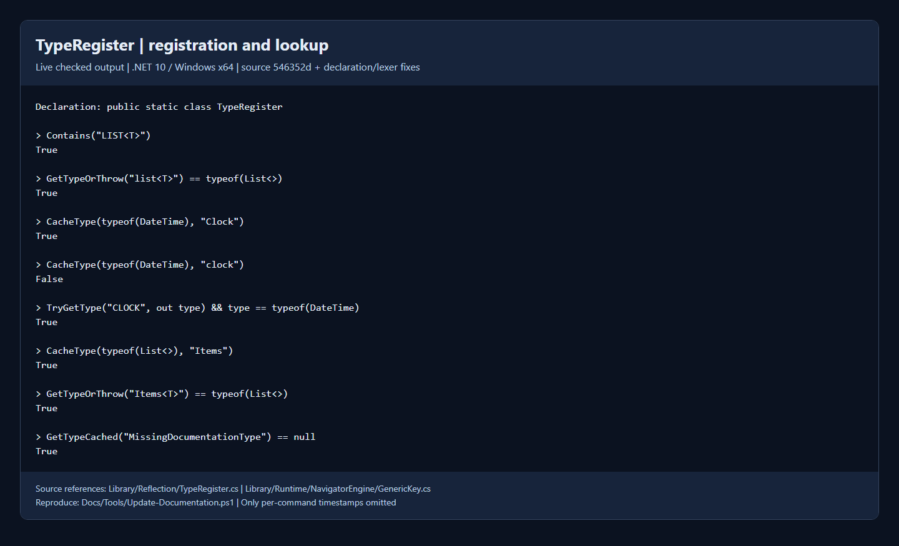

# TypeRegister API reference

`XQuinn.Reflection.TypeRegister` is the process-wide, case-insensitive type
registry used by Navigator. Its declaration is:

```csharp
public static class TypeRegister
```

The class is no longer `partial`. This declaration change does not change its
public methods or runtime lookup behavior. The registry and its `GenericKey`
implementation remain private/internal; use the public methods below.

**Source:** [TypeRegister.cs](../Library/Reflection/TypeRegister.cs).

## Register types

```csharp
using System;
using System.Collections.Generic;
using XQuinn.Reflection;

TypeRegister.CacheType(typeof(DateTime), "Clock");
TypeRegister.CacheType(typeof(List<>), "Items");
TypeRegister.CacheType<TimeSpan>(fullname: false);

Type definition = TypeRegister.GetTypeOrThrow("Items<T>"); // typeof(List<>)
```

| Method | Behavior |
| --- | --- |
| `bool CacheType(Type type, string key)` | Register an explicit name; return `true` only when a new entry is added |
| `bool CacheType<T>(string key)` | Register `typeof(T)` with an explicit name |
| `bool CacheType(Type type, bool fullname)` | Derive the key with `GetCompatibleName` |
| `bool CacheType<T>(bool fullname)` | Derive the key for `typeof(T)` |
| `void CacheTypes(IEnumerable<Type> types, bool fullname)` | Register a sequence using derived names |
| `void CacheTypes(IEnumerable<Type> types, bool fullname, string append)` | **Prefix** each derived name with `append` |
| `void CacheTypes(IEnumerable<Type> types, Func<Type, string?> keyProvider)` | Compute each key; a `null` result skips that type |
| `List<(string key, Type type)>? CacheTypesSkipDuplicates(IEnumerable<Type> types, bool fullname)` | Continue past conflicting keys and return the conflicts; return `null` if there are none |

Registration details:

- Registering the same type under the same case-insensitive name and generic
  arity returns `false`; it does not add or replace an entry.
- Registering a different type under an occupied name/arity throws a duplicate
  key exception. `CacheTypesSkipDuplicates` catches that specific conflict only;
  other validation exceptions still propagate.
- Nested types, compiler-generated types, and file-local types are skipped with
  a `false` result. Do not rely on them appearing in a bulk registration.
- Closed generic types, such as `typeof(List<int>)`, are rejected. Register
  `typeof(List<>)`, then use `List<int>` in Navigator to construct a closed type.
- Bulk registration is not transactional: entries added before an exception
  remain registered.

For public types in an assembly:

```csharp
using System.Linq;

TypeRegister.CacheTypes(
    typeof(TypeRegister).Assembly.GetTypes().Where(type => type.IsPublic),
    fullname: false);
```

For custom prefixes or selective registration:

```csharp
TypeRegister.CacheTypes(
    new[] { typeof(DateTime), typeof(TimeSpan) },
    fullname: false,
    append: "SystemTools.");

TypeRegister.CacheTypes(
    typeof(TypeRegister).Assembly.GetTypes(),
    type => type.IsPublic
        ? "XQ." + TypeRegister.GetCompatibleName(type, fullname: false)
        : null);
```

## Look up and enumerate types

| Member | Result |
| --- | --- |
| `bool Contains(string name)` | Whether the name/arity is registered |
| `bool TryGetType(string name, out Type? cachedtype)` | Lookup without throwing for an absent entry |
| `Type? GetTypeCached(string name)` | Registered type, or `null` when absent |
| `Type GetTypeOrThrow(string name)` | Registered type, or `ArgumentException` when absent |
| `IEnumerable<string> Keys()` | Registered display keys, including generic placeholders |
| `ICollection<Type> Values` | Registry values |
| `IEnumerable<KeyValuePair<string, Type>> Enumerate()` | Display-key/type pairs |

Lookup is case-insensitive. Use well-formed names without surrounding whitespace.
The lookup methods select a **definition by name and generic argument count**;
they do not substitute concrete arguments:

```csharp
TypeRegister.GetTypeOrThrow("LIST<T>") == typeof(List<>); // true
```

To get a closed type from C#, call `MakeGenericType` on the returned definition.
In Navigator, `Types.Of<List<int>>()` performs generic construction through the
Navigator parser, while `Types.Of("List<T>")` returns the cached definition.

`List` and `List<T>` are different keys. Different arities can share the same
base name. Generic placeholder spelling is not part of key identity.

## Compatible names and key restrictions

`GetCompatibleName(Type type, bool fullname)` derives a registration name from
`Name` or `FullName`. For generic definitions it removes the reflection backtick
suffix; for supported nested-name formatting it replaces `+` with `.`. Name
formatting does not make nested types eligible for registration.

Use simple identifier segments separated by single periods:

```text
Clock
SystemTools.Clock
Items
```

Do not put `<T>`, commas, spaces, numeric suffix notation, or other punctuation
in a **registration** key. The generic arity is taken from the `Type` itself.
`Items<T>` is a valid **lookup** display key after registering `Items` for an
open one-argument generic definition.

The validator rejects empty/whitespace keys, an initial digit or period,
unsupported punctuation, consecutive periods, and namespace segments beginning
with a digit. The names `null`, `default`, `base`, `this`, `true`, and `false` are
reserved, ignoring case. Prefer letters/underscores at the start of every
segment and avoid trailing periods. See the internal `ThrowIfBadKey` method in
[the source](../Library/Reflection/TypeRegister.cs) for the implemented checks;
it is **not** a public validation API.

## Precached types

The static initializer registers primitive aliases (including `int`, `uint`,
`long`, `float`, and `bool`), common collection definitions, reflection/runtime
helpers, and Navigator's internal `Types` helper. `Tuple` names `ValueTuple`,
and `KVP<T1, T2>` names `KeyValuePair<,>`. The `Type` key is backed by
`System.RuntimeType` in the current implementation.

For an authoritative list at runtime, enumerate `Keys()` or `Enumerate()` rather
than assuming all .NET types are registered. There is no public clear/remove
operation, and `Navigator.Clear()` does not reset this registry. The backing
dictionary is not synchronized; coordinate registration and lookup in your host.

## Verified capture



[Plain-text transcript](Screenshots/type-register.txt) ·
[Regeneration and capture rules](README.md#screenshot-rules)

## Source references

- [TypeRegister declaration, static initializer, and public methods](../Library/Reflection/TypeRegister.cs)
- [Generic key identity and query arity](../Library/Runtime/NavigatorEngine/GenericKey.cs)
- [Navigator generic construction](../Library/LangInterp/SyntaxTree/TypeString.cs)
- [Internal TypeBook and file-local type detection](../Library/Reflection/TypeBook.cs)
- [Navigator usage guide](Runtime.Navigator.md)